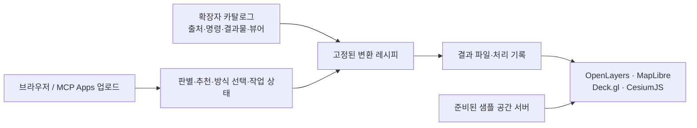

# geo-web-bridge — 공간 데이터 시각화

공간 데이터를 **수집 → 전처리 → 웹 형식 변환 → 지도·3D로 확인**하는 프로젝트입니다. 같은 원본을 파일 또는 공간 서버로 제공하는 방식과 웹 뷰어별 표현을 비교합니다.

**공개 사이트:** [geospatial.kro.kr](https://geospatial.kro.kr) · [데이터 시각화](https://geospatial.kro.kr/viz) · [내 파일 업로드](https://geospatial.kro.kr/viz/upload) · [AI 연결 안내](https://geospatial.kro.kr/ai)

[다른 도구와의 차이](#compare) · [작업 범위](#scope) · [MCP Apps 연결 방법(베타)](#mcp-apps) · [주소·코드 연계](#link) · [QGIS 플러그인](#qgis) · [배포 상태](#deployment) · [처리 구조](#architecture) · [라이선스](#license) · [개발 중인 사항](#in-progress)

## 다른 도구와의 차이

조사 기준일 2026-11-03. 지리공간 MCP 서버는 대부분 지오코딩·경로·공간 분석이나 특정 플랫폼 연동을 다루며, 올린 파일을 웹 지도 라이브러리용 결과로 바꿔 주는 서버는 드뭅니다.

| 비교 대상 | 하는 일 | 이 프로젝트와 다른 점 |
|---|---|---|
| [Cesium ion MCP](https://cesium.com/learn/ion/mcp/) | 대화 안 업로드 화면 → ion 타일링 → ion 자산으로 관리. OAuth 로그인 | CesiumJS·ion 중심. 이 프로젝트는 2D 벡터·래스터까지 다루고 웹 라이브러리 4종을 대상으로 결과 파일을 줍니다 |
| [Mapbox MCP](https://github.com/mapbox/mcp-server) | 요청에 담긴 GeoJSON을 Mapbox GL 지도로 대화 안에 표시, 지오코딩·경로 | 파일 변환·타일 생성 없음 |
| [gdal-mcp](https://pypi.org/project/gdal_mcp) · [gis-mcp](https://github.com/mahdin75/gis-mcp) | 로컬 실행, 형식 변환·재투영·공간 분석 | PMTiles·MVT·3D Tiles·점군·CityGML·IFC 결과와 대화 안 화면 없음 |
| Felt·CARTO 등 플랫폼 MCP | 플랫폼에 데이터를 가져와 지도 발행 | 결과가 플랫폼 안에 머묾. 플랫폼 계정 필요 |
| [qgis2web](https://plugins.qgis.org/plugins/qgis2web/) · [MapSplat](https://plugins.qgis.org/plugins/mapsplat/) (QGIS 플러그인, 2026-11-06 확인) | QGIS 프로젝트 → OpenLayers·Leaflet 또는 MapLibre+PMTiles 정적 웹 지도 | 이 프로젝트의 QGIS 플러그인은 4개 라이브러리 중 고른 대상용 결과 파일 + 적용 코드 또는 HTML 지도를 주고, 웹·AI와 같은 서버 규칙을 씁니다. 3D(점군·CityGML·IFC)는 웹·AI 쪽에서 |

이 프로젝트의 기준:

- **대상 라이브러리 지정:** OpenLayers·MapLibre·Deck.gl·CesiumJS 중 쓸 곳을 받아 결과 형식·도구를 고르고, 맞지 않는 조합은 이유와 대안을 줍니다.
- **2D부터 3D까지 한 경로:** 벡터 타일(MVT·PMTiles), COG·래스터 타일, 지형(Terrain-RGB·quantized-mesh), 점군·CityGML·IFC의 3D Tiles.
- **가져가는 결과:** 결과 zip·외부 주소 의존 검사·호스팅 조건(MIME·Range·CORS)·라이브러리별 적용 코드. 또는 qgis2web처럼 바로 열리는 HTML 지도 폴더(결과 + index.html + 라이브러리). 내려받은 뒤에는 이 서버와 무관하게 씁니다.
- **로그인 없음:** 접속자별 하루 업로드 한도와 동시 변환 1개로 공개 운영합니다.

## 작업 범위

카탈로그는 **8개 데이터 유형·26개 예시·71개 샘플 처리 경로**를 포함합니다. 준비된 예시를 열어 처리 단계와 결과를 비교하거나, 자신의 파일을 업로드해 파일 방식으로 변환하고 결과 지도·파일을 받을 수 있습니다.

아래 표는 **공개 배포의 파일 방식 업로드** 기준입니다. ✓는 해당 형식에 연결된 변환 결과를 표시할 수 있다는 뜻이며, 모든 뷰어가 원본 확장자를 직접 읽는다는 뜻은 아닙니다. 변환 방식에 따라 선택할 수 있는 뷰어가 달라집니다. Deck.gl 화면은 MapLibre 배경지도 위에 Deck.gl을 겹친 구성입니다.

| 데이터 | 업로드하는 확장자·묶음 | OpenLayers | MapLibre | Deck.gl | CesiumJS | 결과와 입력 조건 |
|---|---|:---:|:---:|:---:|:---:|---|
| 좌표 표 | `.csv` | ✓ | ✓ | ✓ | ✓ | 좌표 열이 있는 CSV → GeoJSON·MVT·PMTiles. UTF-8/CP949, 평면 좌표는 원본 좌표계 선택 |
| 2D Shapefile | `.zip` | ✓ | ✓ | ✓ | ✓ | `.shp`·`.shx`·`.dbf` 등 구성 파일을 함께 묶음. `.prj`가 없으면 좌표계 선택 |
| 2D GeoJSON | `.geojson`, `.json` | ✓ | ✓ | ✓ | ✓ | FeatureCollection → GeoJSON·MVT·PMTiles |
| GML | `.gml` | ✓ | ✓ | ✓ | ✓ | 일반 2D GML → GeoJSON·MVT·PMTiles. CityGML은 별도 형식 선택 |
| GeoPackage | `.gpkg` | ✓ | ✓ | ✓ | ✓ | 여러 레이어는 병합하여 변환 |
| FlatGeobuf | `.fgb` | ✓ | ✓ | ✓ | ✓ | GeoJSON·MVT·PMTiles로 변환 |
| 벡터 PMTiles | `.pmtiles` | ✓ | ✓ | ✓ | ✓ | 앞 세 뷰어는 PMTiles, CesiumJS는 변환한 GeoJSON 사용. 래스터 PMTiles 제외 |
| 높이·층수가 있는 2.5D 건물 | `.geojson`, `.json`, SHP 구성 파일 `.zip` | — | ✓ | ✓ | ✓ | 높이 속성 GeoJSON 돌출 또는 3D Tiles. MapLibre는 GeoJSON 돌출 경로 사용 |
| GeoTIFF·COG 영상 | `.tif`, `.tiff` (`.cog.tif` 포함) | ✓ | ✓ | ✓ | ✓ | COG·XYZ 래스터 타일. OpenLayers는 COG를 직접 읽는 경로도 제공 |
| 일반 영상 | `.jpg`, `.png`, `.webp` 또는 `.zip` | ✓ | ✓ | ✓ | ✓ | 단일 이미지·XYZ 타일. 제자리에 놓으려면 월드파일·`.prj`를 함께 ZIP으로 업로드 |
| DEM 지형 | `.img`, `.tif`, `.tiff` | — | ✓ | ✓ | ✓ | 높이 1밴드. MapLibre/Deck.gl은 Terrain-RGB, CesiumJS는 quantized-mesh |
| Quantized-mesh 지형 | `.zip` | — | — | — | ✓ | `layer.json`과 `.terrain` 타일 폴더를 함께 묶음 |
| LAS·LAZ 점군 | `.las`, `.laz` | — | — | ✓ | ✓ | 좌표계가 포함된 점군 → 3D Tiles |
| PNTS 점군 타일셋 | `.zip` | — | — | ✓ | ✓ | `tileset.json`과 `.pnts` 타일을 함께 묶음 |
| glTF 모델 | `.glb`, `.gltf` 또는 `.zip` | — | — | ✓ | ✓ | GLB·3D Tiles. 외부 `.bin`·텍스처가 있으면 glTF와 함께 ZIP으로 업로드 |
| CityGML | `.gml`, `.citygml` | — | — | ✓ | ✓ | CityGML 1.0/2.0 → 3D Tiles. 파일 좌표계 사용, 텍스처 미사용 |
| i3dm 인스턴스 타일셋 | `.zip` | — | — | — | ✓ | `tileset.json`·`.i3dm`·참조 모델을 함께 묶음. 현재 Deck.gl 경로는 지원하지 않음 |
| IFC BIM | `.ifc` | — | — | ✓ | ✓ | IFC2x3/IFC4 → GLB·3D Tiles. IfcMapConversion(지도 좌표·방향) 또는 IfcSite 위경도가 있으면 그 위치, 없으면 서울시청 앞에 배치 |

- **샘플에서만 제공하는 입력:** MVT(`.mvt`, `.pbf`) 예시가 있습니다. 타일 한 장은 위치(`z/x/y`)를 알 수 없어 업로드하지 않습니다. 타일 묶음을 벡터 PMTiles로 만든 뒤 `.pmtiles`로 업로드해야 합니다. CesiumJS의 MVT 예시는 대체 GeoJSON 결과를 사용합니다.
- **샘플 서버 방식:** 준비된 GeoServer·Martin 예시는 읽기 전용으로 열 수 있습니다. DEM의 OpenLayers 2D WMS나 2.5D 건물의 2D 지도처럼 위 업로드 표와 다른 표시 경로도 있습니다. 새 업로드를 서버의 DB 표·레이어로 발행하는 기능은 공개 배포에서 제공하지 않습니다.
- **입력 범위:** ZIP은 여러 파일이 필요한 형식을 위한 묶음입니다. KML/KMZ·DXF·GPX·MBTiles·ASC·OBJ/FBX·E57 등 카탈로그 밖 형식은 받지 않습니다. 이름이 같은 확장자라도 영상/DEM, 일반 GML/CityGML처럼 내용에 따라 형식을 골라야 합니다.
- **좌표와 위치:** 좌표계가 없으면 판별 화면의 안내에 따라 원본 좌표계를 선택합니다. 위치 정보가 없는 glTF·IFC·일반 이미지는 지정된 예시 위치에 놓으며, 정밀한 원위치 복원을 의미하지 않습니다.

실제 기준은 [형식별 카탈로그](shared/catalog), [뷰어별 출력 종류](shared/viewers.ts), [업로드 판별](shared/sniff.ts)입니다. [결과 화면 예시](docs/images/view-citygml.jpg)와 [점군 화면 예시](docs/images/view-las.jpg)도 볼 수 있습니다.

## MCP Apps 연결 방법(베타)

**MCP Apps 연동은 베타 기능입니다.** 대화에서 "이 데이터를 ○○ 지도 라이브러리에서 쓰고 싶다"고 요청하면, 서버가 파일 특성과 뷰어 호환성으로 변환 방식을 추천하고, 사용자가 확인하거나 바꾼 조건으로 변환한 뒤 그 라이브러리에 바로 쓸 결과 파일·주소·적용 코드를 줍니다. GDAL·tippecanoe·mago·py3dtiles 같은 도구 이름을 몰라도 됩니다. [웹 업로드 화면](https://geospatial.kro.kr/viz/upload)도 같은 추천 규칙을 씁니다. 실제 Claude·ChatGPT 계정의 호스트 연결은 아직 검증하지 않았습니다([검증 범위](#mcp-verified)).

| 항목 | 값 |
|---|---|
| 서버 이름 | `geo-web-bridge` |
| 공개 MCP 주소 | `https://geospatial.kro.kr/mcp` |
| 전송 방식 | Streamable HTTP |
| 공개 배포 인증 | 로그인 없음 |
| 대화 안 화면 리소스 | `ui://geo/app.html` |

MCP Apps는 MCP 도구에 업로드·선택·진행·결과 화면을 붙이는 확장입니다. MCP 연결을 지원하는 것과 대화 안 앱 화면을 지원하는 것은 다릅니다. Apps 미지원 클라이언트는 도구의 텍스트 결과와 브라우저 주소를 사용합니다. [MCP Apps 공식 설명](https://apps.extensions.modelcontextprotocol.io/api/documents/overview.html).

### 연결과 사용

1. MCP Apps를 지원하는 호스트에서 **사용자 지정 원격 MCP 서버/커넥터 추가**를 엽니다. 이름은 `geo-web-bridge`, URL은 위 `/mcp` 주소를 입력합니다. 인증 방식은 **로그인 없음 / No sign in**을 선택합니다. Claude의 현재 연결 절차는 [공식 커넥터 안내](https://support.claude.com/en/articles/11175166-get-started-with-custom-connectors-using-remote-mcp)를 참고합니다.
2. 대화에서 `geo-web-bridge` 커넥터를 켜고 원하는 결과를 말합니다. 모델이 요청에서 대상 라이브러리(`viewer`)·목적(`priority`)·결과 형식(`outputKind`)·제공 방식(`delivery`)을 읽어 `geo_identify`에 넘기면, 그 조건을 미리 고른 업로드 화면이 열립니다. 조건을 모르면 생략해도 됩니다(라이브러리 미지정 = 뷰어별 후보 제시).
3. **앱 화면 안에 파일을 올리면** 서버가 형식을 판별하고 추천합니다. 추천 카드는 변환 방식 → 대상 라이브러리용 주력 결과물 → 추천 이유 → 주의사항(손실·배치 제약) 순서입니다. 라이브러리·목적을 바꾸면 서버가 다시 계산하고, **다른 방식 보기(고급 설정)**에서 다른 방식을 직접 고를 수 있습니다. 화면에서 바꾼 조건이 그대로 변환에 쓰이고 대화에도 전달되며, 사용자가 바꾼 뒤에는 AI 쪽 이전 값으로 덮어쓰지 않습니다. 일반 채팅 첨부 파일이 자동으로 이 서버에 전달되는 구조는 아닙니다.
4. 변환이 끝나면 대상 라이브러리용 주력 결과물·내려받기·리소스 URL·적용 코드·호스팅 조건·결과 파일 검사·결과 지도(고른 라이브러리로 열림)를 확인합니다. 결과 지도의 **선택** 버튼을 켜고 누르면 피처 속성, 모델·타일셋 정보, 래스터·지형 레이어 정보와 위치가 보입니다. 대화 안 앱을 표시하지 못하면 [브라우저 업로드 화면](https://geospatial.kro.kr/viz/upload)을 사용합니다.

### 요청 예시

| 요청 | 모델이 넘기는 조건 | 추천 (시험 파일 기준) |
|---|---|---|
| "이 SHP를 MapLibre에서 대용량으로 쓰게" | `viewer=maplibre`, `priority=large_data` | tippecanoe → PMTiles (대안: GDAL → MVT) |
| "CesiumJS에서 쓸 수 있게" (SHP) | `viewer=cesium` | GDAL → GeoJSON (CesiumJS는 벡터타일 미지원) |
| "PMTiles로만 만들어 줘" | `outputKind=pmtiles` | 라이브러리를 묻지 않고 tippecanoe → PMTiles |
| "이 LAS를 OpenLayers에서" | `viewer=ol` | 미지원 이유(2D 지도 — 3D 점군 미지원)와 대안(Deck.gl·CesiumJS → 3D Tiles) |
| "원본 정밀도를 최대한 살려서" (LAZ, CesiumJS) | `viewer=cesium`, `priority=fidelity` | py3dtiles → 3D Tiles (좌표 양자화 없음) |
| "WMS 응답을 시험해 보고 싶어" | `delivery=service` | 서비스 허용 서버: GeoServer (48시간 임시). 공개 서버: 미지원 이유와 파일 대안 |

### 추천 기준

추천은 별도 LLM을 부르지 않고 서버의 명시 규칙([shared/recommend.ts](shared/recommend.ts))으로 계산합니다. 모델은 요청에서 조건만 읽어 넘깁니다.

- **호환성:** 레시피별 뷰어 지원(`Recipe.viewers`)과 뷰어가 구현한 결과 종류(`viewerKinds`)에 맞는 결과만 후보입니다. 지원하지 않는 조합은 호환되는 것처럼 표시하지 않고 이유와 실제 가능한 대안을 줍니다.
- **목적:** 일반 = 데이터 크기에 맞춰 통째 파일 또는 타일(카탈로그의 "수 MB·수만 개 이하 / 수십 MB·수십만 개 이상" 기준), 빠른 미리보기 = 작은 데이터는 한 파일, 대용량 = 타일·LOD·PMTiles, 원본 보존 = 단순화·양자화·손실 압축이 없는 결과. 손실 없는 결과가 없으면 그렇다고 밝힙니다.
- **파일 특성:** 크기, 머리글로 확인한 피처·점 수, 좌표계 기록, LAS RGB, IFC 스키마(IFC4면 mago 제외) 등. 이미 웹 형식인 PMTiles는 원본 그대로를 우선합니다. 처리 시간·메모리는 추정하지 않습니다.
- **판정:** 추천·대안·제약 있음(예: glTF는 서울 고정 위치, IFC는 위치 정보가 없으면 서울 배치)·미지원으로 나누고, 손실·배치 주의를 함께 줍니다.
- **재검증:** 변환을 시작할 때 서버가 파일을 다시 판별하고 추천을 계산합니다. 클라이언트가 보낸 방식이 뷰어·결과 형식·제공 방식·좌표계 조건에 맞지 않으면 시작하지 않습니다.

| 공개 도구 | 역할 |
|---|---|
| `geo_formats` | 받을 수 있는 형식, 파일 변환 방식, 뷰어별 지원 조회 |
| `geo_identify` | 업로드 화면 열기(대상 라이브러리·목적을 미리 선택), 맡긴 파일의 형식·좌표계 판별과 추천 |
| `geo_recommend` | 대상 라이브러리·목적·결과 형식·제공 방식에 맞는 방식 추천과 이유·손실·미지원 설명 (읽기 전용, 변환 안 함) |
| `geo_convert` | 맡긴 파일을 변환 시작. `method` 생략 = 추천 방식. 서버가 뷰어·형식·제공 방식 조건을 다시 확인 |
| `geo_status` | 진행·실패 이유, 완료 후 주력 결과물·내려받기·리소스 URL·적용 코드·결과 파일 검사, 서비스 상태·만료 시각 |
| `geo_stage_chunk` | 앱 화면의 파일 조각 업로드용 내부 도구 |

MCP Apps를 표시하지 못하는 클라이언트도 `geo_identify(stage)` → `geo_recommend` → `geo_convert` → `geo_status`의 텍스트·structuredContent로 같은 추천·결과·만료 정보를 받습니다. 웹 업로드로 만든 작업 id를 `stage`로 쓰면 같은 파일을 다른 조건으로 다시 변환할 수 있습니다.

### 결과 제공 방식

**파일과 서비스는 목적과 이용 기간이 다릅니다.**

| 구분 | 목적 | 기간 |
|---|---|---|
| 파일 (기본) | 자신의 웹 프로젝트·서버에 가져가 쓰는 완성형 결과 파일. 여러 파일 결과(타일 폴더·3D Tiles·지형)는 폴더 구조 그대로 zip. 결과 안에 geo 서버 주소 의존이 없는지 서버가 검사 | 내려받은 파일은 서버와 무관하게 계속 사용. 서버의 원본·결과 사본과 내려받기 URL은 운영자가 정리할 때까지 보관(기간 보장 없음) |
| 서비스 | GeoServer·martin에 발행한 WMS·WMTS·WFS·OGC API Features·MVT의 실제 응답과 웹 지도 연동 확인 | **발행 완료 후 48시간.** 만료 뒤 서비스 URL은 410, 정리 작업이 이 작업의 DB 표·레이어·저장소·스타일을 삭제. 연장·자동 갱신 없음 |

- 파일 결과에는 좌표계·범위·레이어 이름·속성 이름, 형식별 호스팅 조건(MIME, Range 요청, CORS), 대상 라이브러리 적용 코드가 함께 나옵니다. 코드는 URL만 내려받아 올린 곳 주소로 바꾸면 그대로 쓰며, 배경지도·웹 앱 구성은 직접 해야 합니다.
- **최종본 형태**(파일 방식): ① 결과 파일 + 적용 코드 — 이미 있는 웹 프로젝트에 넣어 씀. ② **바로 열리는 HTML 지도** — 결과 + 지도 페이지(`index.html`, 적용 코드와 같은 코드) + 라이브러리(`lib/`)를 한 폴더 zip으로. 정적 호스팅(GitHub Pages·Netlify·사내 웹 서버)에 폴더째 올리면 그대로 열리고, 배경지도는 OpenStreetMap. 같은 변환 결과로 둘 다 받을 수 있으며 고른 쪽을 먼저 보여 줍니다. OpenLayers·MapLibre·Deck.gl은 라이브러리를 폴더에 담아 CDN 없이 열리고, CesiumJS는 수십 MB라 CDN에서 불러옵니다.
- 결과 파일 검사(형식 머리글, `tileset.json`·`layer.json`이 가리키는 파일 존재, 절대 주소 의존)와 브라우저 렌더링 확인은 별개입니다. 렌더링은 결과 지도에서 확인합니다.
- 서비스 발행은 허용된 실행 환경(로컬 등)에서만 동작하며 **공개 배포는 파일만 제공**합니다. 공개 서버에 서비스를 요청하면 파일로 바꾸지 않고 미지원 이유와 파일 대안을 안내합니다.

### 검증 범위 (2026-11-02)

- **공식 SDK AppBridge 시험:** AI가 넘긴 `viewer=cesium`으로 화면이 열림 → 사용자가 MapLibre로 바꾸면 추천과 `geo_convert` 인자가 바뀜 → 실제 변환·결과 지도·내려받기 ([시험](tests/viz/mcp-app.test.ts)).
- **화면 없는 흐름:** `geo_identify` → `geo_recommend` → `geo_convert` → `geo_status`, 조건에 맞지 않는 방식 거절, 여러 파일 결과 zip의 파일 수·구조.
- **형식별 실제 변환:** 시험 파일 33종(25개 형식 + 좌표계·인코딩·폴더 구조 경계 사례)을 추천 방식으로 변환해 결과 파일 검사 통과, 고른 라이브러리의 결과 지도에서 표시 확인. 받을 수 없는 파일 7종은 변환 전에 이유 안내.
- **서비스 48시간:** 서비스를 허용한 로컬 시험 서버에서 이용 기간을 줄여 만료 전 200 → 만료 뒤 410 → 리소스 정리를 확인. 만료 판정·정리 재시도·소유 확인은 시계를 주입한 단위 시험으로 확인([시험](tests/viz/delivery.test.ts)).
- **미검증:** 실제 Claude·ChatGPT 계정의 호스트 연결과 호스트별 앱 표시·도구 승인·파일 내려받기.

공개 연결에서는 **외부 URL 가져오기와 서버 PC 파일 경로 읽기를 제공하지 않습니다.** `geo_engine`의 Unreal 실행과 주소·코드 연계의 대량 파일 작업도 공개 기능에 포함하지 않습니다. 호스트의 도구 승인·앱 표시·내려받기 지원은 해당 클라이언트의 기능에 따릅니다.

## 국내 주소·코드 연계 도구

[주소·코드 변환](https://geospatial.kro.kr/link)은 PNU·법정동코드·행정동코드·지번주소·도로명주소·좌표를 한 줄씩 넣으면 줄마다 유형을 판별해 결과를 한 번에 줍니다. 법정동 경계는 SHP ZIP으로 받습니다.

| 입력 | 결과 |
|---|---|
| PNU 19자리, 법정동코드 2·5·8·10자리 | 주소, 시도·시군구·읍면동·리 코드와 이름, 행정동, 대표 위치 |
| 지번주소 (예: `서울 강남구 역삼동 737`) | PNU와 위 결과 전체, 우편번호 |
| 도로명주소 (예: `세종대로 110`) | 건물의 대표지번 PNU, 건물 위치, 우편번호 |
| 행정동코드 | 관할 법정동과 이름 |
| 좌표 (EPSG:4326·3857·5179·5186·5181) | 역조회한 주소·PNU·법정동·행정동, 좌표계 변환 |

- **기준자료:** 법정동은 행정안전부 행정표준코드관리시스템 전체자료(53,403건, 폐지 포함), 행정동은 행정안전부 행정동코드·관할 관계. 위치·도로명주소·우편번호·경계는 VWorld(지오코더·검색·2D 데이터 API).
- **해석 규칙:** 같은 이름이 여러 곳이면 후보를 보여 주고 고르게 합니다(임의 확정 없음). 이름이 하나뿐이면 빠진 상위·사이 단계(예: `부천시 중동` → 원미구)를 사전에서 채우고 경고로 알립니다. 옛 시도명·코드(제주도 49→50, 강원도 42→51, 전라북도 45→52)는 명칭 변경에 따른 현재 코드로 바꾸고 알립니다. `서울시`·`번지` 표기도 읽습니다. 법정동 하나에 행정동이 여럿이면 필지·건물 위치를 역조회한 행정동으로 정합니다.
- **범위:** PNU는 형식 조합이며 실제 필지 존재(지적 대장)는 확인하지 않습니다. 도로명주소의 PNU는 건물의 대표지번이며, 여러 필지에 걸친 건물은 관련지번이 더 있을 수 있습니다.
- **한도:** 위치까지 한 번에 받는 변환은 20줄, 코드·주소만은 200줄. 공개 서버는 외부 원천을 부르는 조회를 접속자별 하루 2,000줄로 제한합니다.
- **AI:** MCP `geo_link_resolve`에 줄 단위 `text`와 `options={target:"all"}`.

## QGIS 플러그인

QGIS에서 [사용자 지정 저장소](https://geospatial.kro.kr/qgis) `https://geospatial.kro.kr/qgis/plugins.xml` 하나를 추가하면 두 플러그인을 설치·업데이트합니다. QGIS 3.28 이상(QGIS 4 포함)이고 추가 Python 패키지는 필요 없습니다.

| 플러그인 | 하는 일 |
|---|---|
| geo-web-bridge 웹 지도 변환 | 레이어(2D 벡터·래스터)를 대상 라이브러리·목적에 맞는 웹 결과로. 결과 파일 + 적용 코드 또는 바로 열리는 HTML 지도로 받고, 결과(GeoJSON·타일 폴더·COG)를 QGIS에 다시 불러와 확인. 레이어 좌표계를 그대로 보내 좌표계를 고를 일이 없음 |
| geo-web-bridge 주소·코드 연계 | 속성 표의 PNU·법정동코드·행정동코드·지번주소·도로명주소 열을 주소·PNU·단계별 코드·행정동·우편번호·위치로 바꿔 새 레이어에 붙이고, 위치로 점 레이어도. 원본은 바꾸지 않음. 외부 조회를 끄면 사전만으로 200줄씩 한도 없이 |

플러그인 원본은 [qgis/](qgis), 저장소(zip·plugins.xml)는 빌드 때 [scripts/qgis-plugins.ts](scripts/qgis-plugins.ts)가 만듭니다. 서버 칸에 직접 설치한 서버 주소를 넣으면 외부로 보낼 수 없는 자료도 같은 규칙으로 변환합니다.

## 배포 상태

기준일: **2026-11-01**. GitHub 저장소의 코드·문서와 서버에 준비된 데이터는 구분합니다. 대용량 원본·변환 결과는 Git에 넣지 않고 서버에 보관합니다.

| 기능 | 공개 배포 상태 |
|---|---|
| 웹 화면·4종 웹 뷰어 | [geospatial.kro.kr](https://geospatial.kro.kr)에서 제공 |
| 예시 데이터 | 26개 형식·71개 샘플 처리 경로 준비 완료 |
| 흐름도 | Windows/OS 움직임 줄이기 설정과 관계없이 기본 재생, 직접 끄기 가능 |
| 웹 파일 업로드 | 파일 업로드·라이브러리·목적별 추천·파일 방식 변환·진행 확인·지도·다운로드 제공 |
| MCP Apps 연동 | **베타**. 공개 `/mcp` 연결과 앱 화면 제공. 실제 Claude·ChatGPT 계정의 호스트 연결은 미검증 |
| 기존 GeoServer·Martin 예시 | 준비된 레이어의 읽기 전용 조회 제공 |
| Cesium for Unreal | 서버에 설치·실행하지 않으며 화면 전환 비활성화 |
| 국내 주소·코드 연계(`/link`) | 즉시 변환·지역 조회·기준자료 상태·경계 SHP. 위치·우편번호·경계처럼 외부 원천(VWorld)을 부르는 조회는 접속자별 하루 2,000줄. CSV·XLSX 대량 작업은 비공개 실행에서만 |

### 배포 화면에서 현재 불가능한 사항

- 업로드한 데이터를 PostGIS·GeoServer·Martin의 새 서비스로 발행하거나 관리 API를 호출할 수 없습니다. 공개 업로드는 결과 파일을 만드는 방식으로 제한합니다.
- URL을 입력해 서버가 대신 내려받거나, 서버 PC의 파일 경로를 지정해 읽을 수 없습니다. 브라우저 또는 MCP Apps 업로드 화면으로 파일을 전달합니다.
- 파일은 **최대 200MB**, 업로드는 **접속자(IP)별 하루 1GiB**, 변환은 **서버 전체에서 동시에 1개**입니다. 다른 변환이 실행 중이면 대기열에 쌓지 않고 다시 시도하도록 알립니다. 처리 가능한 형식이어도 파일 크기·구조·도구의 처리 시간에 따라 실패할 수 있습니다.
- 계정별 비공개 파일 보관함을 제공하지 않습니다. 업로드 원본과 결과는 운영자가 명시적으로 정리하기 전까지 보존합니다(보관 기간 보장 없음 — 계속 쓸 결과는 내려받기). 서비스 방식의 48시간 만료는 결과 파일 보관과 별개입니다.
- Cesium for Unreal의 실제 엔진 화면·Pixel Streaming과 `geo_engine` 실행은 제공하지 않습니다. 웹 CesiumJS 지도는 별도로 사용할 수 있습니다.
- 표에 없는 확장자, 단독 MVT/PNTS/i3dm/terrain 타일, 카탈로그가 지원하지 않는 모델 확장이나 참조 파일 누락을 자동으로 보완하지 않습니다.

## 처리 구조

웹 화면은 Nuxt 4·Vue 3·TypeScript, 변환은 Node 실행기와 버전을 정한 Docker 도구를 사용합니다. GDAL·PDAL·tippecanoe·mago·py3dtiles·IfcConvert 등은 형식별 레시피로 연결됩니다. 처리 명령과 로그·시간은 실행 기록에 남고 화면은 카탈로그와 그 기록을 읽습니다. 서버의 데이터 처리는 별도 rootless Docker 엔진을 사용합니다. [구현·운영 상세](docs/visualization.md), [배포 구성](deploy/README.md).

## 라이선스

| 대상 | 적용 조건 |
|---|---|
| 이 저장소의 자체 코드·문서 | **[MIT License](LICENSE)**, Copyright © 2026 Gi-Di-Zi. 사용·수정·재배포 시 저작권과 허가 문구를 유지하며 무보증 조건이 적용됩니다. |
| 샘플 원본·변환 결과·모델·타일 | **각 원본 데이터의 라이선스**를 따릅니다. 이 저장소의 MIT가 데이터 이용·재배포 권한을 대신하지 않습니다. 출처표시·가공 표시·재배포 조건은 각 자료별로 확인해야 합니다. |
| 사용자가 업로드한 자료 | 저장소의 MIT 적용 대상이 아닙니다. 해당 자료의 원래 이용조건과 권리 범위를 따릅니다. |
| 배경지도·외부 서비스 | OpenStreetMap 등 각 제공자의 이용조건과 출처표시를 따릅니다. VWorld처럼 키·이용승낙이 필요한 서비스는 별도 조건이 적용됩니다. |
| 외부 라이브러리·Docker 도구 | 각 배포본의 원래 라이선스가 적용됩니다. GPL/LGPL/MPL/Apache/BSD/MIT 등 여러 조건의 도구가 포함되며 모두 MIT로 재허가하는 프로젝트가 아닙니다. |
| Cesium for Unreal 플러그인 | [Apache License 2.0](https://cesium.com/learn/cesium-unreal/ref-doc/)을 따릅니다. Cesium ion과 외부 데이터 서비스를 이용하면 해당 서비스·콘텐츠의 조건도 별도로 적용됩니다. |
| Unreal Engine | **[Epic의 Unreal Engine 라이선스·EULA](https://www.unrealengine.com/license)**를 따릅니다. 프로젝트 코드의 MIT와 별개이며 엔진 자체를 MIT로 제공하지 않습니다. |

데이터 출처와 표기는 [형식별 `collect` 정의](shared/catalog)와 [출처 목록](shared/catalog/sources.ts), 도구의 라이선스·공식 주소는 [도구 카탈로그](shared/catalog/tools.ts)에서 확인할 수 있습니다. 카탈로그에 다른 수급처를 소개했다고 해당 자료를 이 서버에서 제공하거나 재배포를 허용한다는 의미는 아닙니다.

## 개발 중인 사항

| 기능 | 현재 상태와 남은 작업 |
|---|---|
| 업로드 범위 확장 | 현재 표의 파일 변환 방식을 기준으로 제공합니다. 새 서버 레이어 발행, 단독 타일의 위치 복원, 추가 확장자는 공개 업로드 지원에서 제외합니다. |
| 모델의 원위치 배치 | IFC는 IfcMapConversion(지도 좌표·방향)과 IfcSite 위경도로 원위치에 놓습니다(높이는 0 기준, 자오선 수렴각·대지 방향 미보정). glTF의 위치 입력과 IFC 높이 보정이 남아 있습니다. |
| Cesium for Unreal 화면 | 웹 CesiumJS와 다른 실행 환경입니다. 실제 엔진·플러그인·GPU와 화면 송출 구성이 필요합니다. 저장소의 자동 실행기(scripts/unreal.ts)는 Windows(Win64·Build.bat)와 Linux(Linux·Build.sh, zip은 python3로 풀기, 끌 때 프로세스 그룹째 정리)를 나눠 처리합니다. Linux 분기는 가짜 엔진으로 경로·빌드 인자·zip 풀기·프로세스 정리만 확인했고 실제 Ubuntu의 언리얼(Vulkan 오프스크린 렌더링·Pixel Streaming 인코더)은 검증하지 않았습니다. 현재 공개 배포의 엔진 실행·외부 스트리밍 연결은 비활성 상태입니다. |
| MCP Apps 베타·호스트별 앱 연동 | 공식 SDK AppBridge로 조건 전달·추천·변경·변환·결과 지도·내려받기까지 확인했습니다([검증 범위](#mcp-verified)). 실제 Claude·ChatGPT 계정의 호스트 연결과 호스트별 앱 표시·도구 승인·파일 내려받기는 추가 검증이 필요합니다. |
