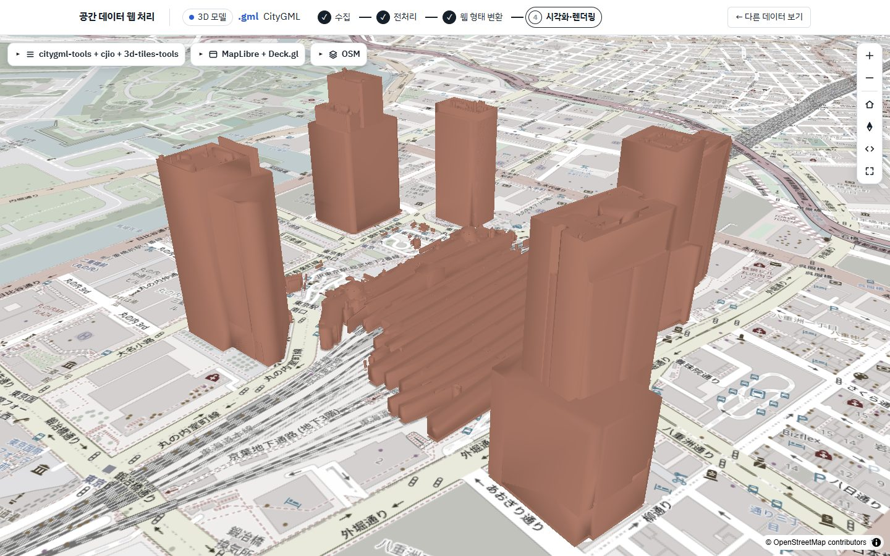
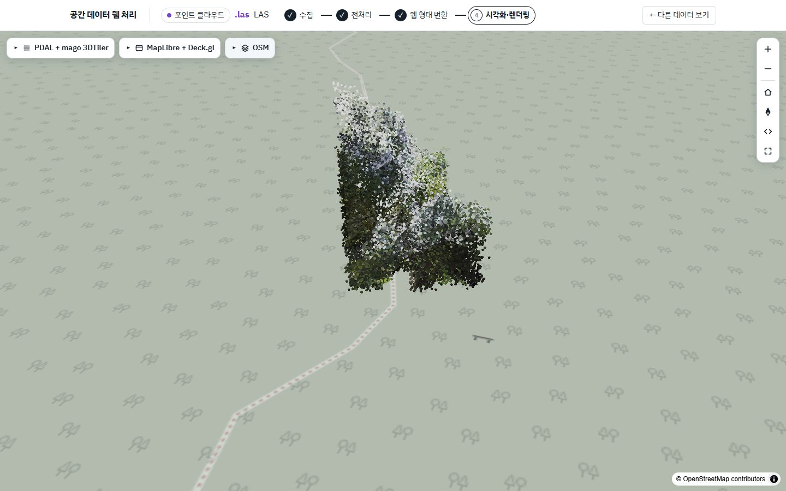
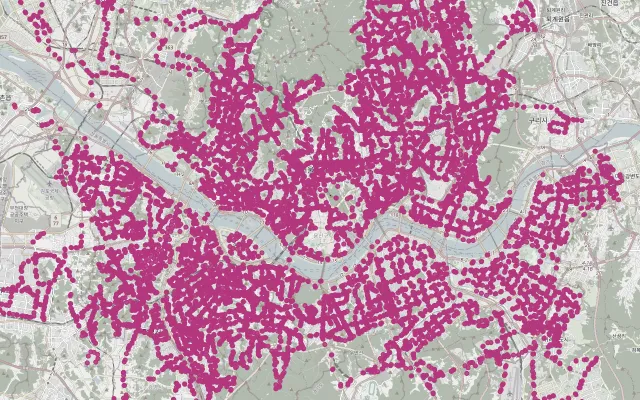
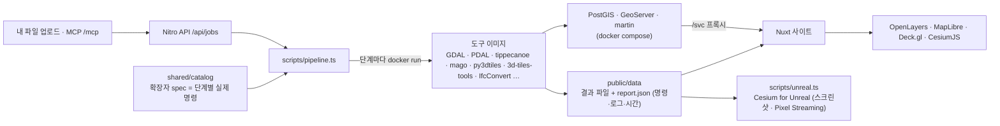

# geo — 공간 데이터 시각화

실제 공개 공간데이터를 **수집 → 전처리 → 웹 형식 변환 → 지도·3D로 확인**하는 개인 프로젝트입니다. 같은 데이터도 좌표계·인코딩·형상과 제공 방식에 따라 웹에서 보이는 결과가 달라집니다. 이 차이를 단계별 명령, 처리 이유, 여러 뷰어의 결과로 비교하고 공개합니다.

CityGML 건물이 엉뚱한 위치에 놓이는 문제, LAS 점군이 바닥지도 위에 떠 보이는 문제, 같은 CSV를 파일과 공간 서버로 제공할 때의 차이를 다룹니다. 실행 환경 없이도 아래 결과 화면과 관련 코드를 확인할 수 있습니다. 제출 형태는 GitHub 저장소이며 라이브 배포는 제공하지 않습니다.

[대표 사례](#cases) · [처리 구조](#architecture) · [문제 해결 기록](#troubleshooting) · [개발 방식과 역할](#role) · [실행 방법](#run) · [검증과 한계](#validation)

## 대표 결과 화면

| CityGML → 3D Tiles | LAS 점군 → 3D Tiles |
|---|---|
| [](#citygml) | [](#las) |
| citygml-tools → cjio → GLB 경로, MapLibre + Deck.gl | PDAL → mago 경로, 원본 RGB를 유지한 점군 |

[](#csv)

CSV의 위경도를 점으로 만든 결과입니다. [파일·서버 방식 비교 화면](docs/images/convert.jpg)도 볼 수 있습니다. 이미지는 기존 실행 결과 촬영본으로, 이번 작업에서 새로 변환한 결과가 아닙니다. 화면의 예전 제목·메뉴 구성은 현재 앱과 다를 수 있습니다. 배경지도 © OpenStreetMap contributors. 데이터 출처와 가공 범위는 각 사례에 표시합니다.

<a id="cases"></a>
## 대표 사례

아래 시간·용량은 **기존 README에 남아 있는 과거 실행 기록**입니다. 측정 환경은 Ryzen 7 7700, Windows의 Docker Desktop(Docker 29.7.2, 16코어·메모리 31GB 할당), 도구 이미지 다운로드 완료 상태입니다. 시간은 단계 컨테이너 실행 시간의 합이며 서버 기동 시간은 제외합니다. 응답 시간은 같은 요청의 첫 요청/재요청 값입니다. 반복 측정 평균이나 일반적인 성능 우열을 뜻하지 않습니다.

원래의 `report.json`·원본·변환 파일은 Git에서 제외되어 현재 체크아웃에는 없습니다. 이번에는 코드·기존 화면과 설명의 일치를 확인했으며, 표의 수치를 새로 실측하거나 원 보고서와 재대조한 것은 아닙니다. [이번 검증 범위](#validation)를 별도로 구분합니다.

<a id="citygml"></a>
### A. CityGML → 3D Tiles: 좌표를 맞추고 경로를 고르기

**입력:** 일본 PLATEAU 도쿄도 치요다구 2025 건물 데이터. 166MB의 1km 메시에서 도쿄역 일대 85동을 추출한 약 10MB CityGML 2.0 샘플입니다. 좌표계는 EPSG:6697(JGD2011의 위도·경도·높이)입니다. [원본 출처](https://www.geospatial.jp/ckan/dataset/plateau-13101-chiyoda-ku-2025).

**문제와 처리:** EPSG:6697은 위도가 먼저 오는 복합 좌표계입니다. mago가 사용하는 proj4j의 높이 포함 좌표계 처리와 축 순서가 맞지 않아 건물이 바다 위에 놓였던 기록이 있습니다. 직접 변환은 수평 좌표계 `-c 6668`과 축 교환 `-fc`를 함께 사용합니다. GLB 경로는 EPSG:6677의 미터 좌표로 바꾸고 동·북 순서를 강제한 뒤, 도쿄역을 원점으로 옮겨 큰 좌표에 따른 정밀도 저하를 줄입니다. 최종 타일셋은 도쿄역 경위도에 배치합니다.

| 경로 | 과거 처리 시간 | 과거 결과 | 선택 기준과 한계 |
|---|---|---|---|
| mago: CityGML 직접 → 3D Tiles | 25.3초 | 3.3MB, 169파일 | DB 없이 직접 타일 분할·LOD 생성. PLATEAU의 모든 의미·확장 속성 보존까지 검증한 경로는 아님 |
| 3DCityDB 적재 → 건물별 면 집계 → pg2b3dm | 9.1초 | 2.9MB, 3파일 | DB에서 건물 단위로 다룰 때. `gml_id`·`height`를 출력에 명시적으로 포함하며, 전체 원본 속성을 내보내는 것은 아님 |
| citygml-tools → CityJSON → cjio GLB → 3d-tiles-tools | 24.2초 | 0.1MB | 작은 형상 미리보기. 85동을 메시 하나로 압축해 건물별 속성 조회가 불가 |

**결과:** 위 [건물 결과 화면](docs/images/view-citygml.jpg)은 GLB 경로를 웹에서 그린 촬영본입니다. [mago 결과의 Cesium for Unreal 촬영본](docs/images/engine-citygml.jpg)은 별도 선택 경로의 기록입니다. 웹에서는 Deck.gl·CesiumJS가 3D Tiles를 읽고, OpenLayers·MapLibre 기본 레이어는 이 3D 모델을 직접 지원하지 않습니다.

**한계:** 샘플 수집 중 별도 이미지 텍스처 참조를 제거하고, 도구가 지원하지 않는 PLATEAU `uro` 확장 속성도 누락됩니다. 원본의 모든 의미 정보를 보존하는 디지털 트윈으로 주장하지 않습니다. DB 경로의 JGD2011·WGS84 배치는 코드의 근사 처리이며 정밀 측량 검증 대상이 아닙니다.

**관련 코드:** [수집·변환 레시피](shared/catalog/model-3d/citygml.ts), [업로드 파일별 좌표계·축 판별](pipeline/scripts/citygml_crs.py), [Deck.gl 뷰어](app/components/viewers/ViewerDeck.client.vue), [Cesium 뷰어](app/components/viewers/ViewerCesium.client.vue). 앱 경로: `/viz/model-3d/citygml` → `/preprocess` → `/convert` → `/view`.

<a id="las"></a>
### B. LAS 점군 → 웹 시각화: 표시 보정과 원본 의미 구분

**입력:** 국립공원공단 치악산 둘레길 실측 LAS(4족 보행 로봇 스캔). [원본 출처](https://www.data.go.kr/data/15095240/fileData.do)의 ZIP 약 212MB, LAS 약 486MB·1,351만 점에서 20개 중 1개를 남긴 675,472점 샘플입니다. LAS 1.4·점 형식 7의 RGB를 유지합니다.

**문제와 처리:** 파일 VLR이 `LOCAL_CS`여서 지리 좌표계를 바로 알 수 없습니다. 샘플 코드는 좌표 범위에 근거해 EPSG:5187로 판단해 지정하고, 두 도구 공통 입력인 EPSG:3857로 재투영합니다. 이것은 파일에 올바른 EPSG 코드가 들어 있었다는 뜻이 아닙니다. 분류 7·18의 노이즈를 제외하고 최저 Z를 0으로 내려, 지형 없는 높이 0의 바닥지도 위에 점군이 떠 보이는 현상을 줄입니다.

| 도구 | 과거 전체 시간 (변환 단계) | 과거 결과 | 선택 기준 |
|---|---|---|---|
| PDAL + mago | 94.5초 (90.6초) | 8.4MB, 91파일 | 샘플에서는 파일 수·결과 용량이 더 작음. 입력 규모가 커질 때는 처리 시간 고려 |
| PDAL + py3dtiles | 17.7초 (12.8초) | 9.8MB, 123파일 | 샘플에서는 변환이 더 빠름. 부모·자식 점을 누적하는 `ADD`로 타일 refine 보정 필요 |

**결과:** [기존 실제 점군 화면](docs/images/view-las.jpg)에서 숲길 스캔의 형태와 원본 RGB를 확인할 수 있습니다. Deck.gl·CesiumJS로 3D Tiles(pnts)를 읽습니다. 도구 선택은 위 샘플 결과에 한정하며 모든 점군에서의 우열로 일반화하지 않습니다.

**한계:** 최저 높이 정렬은 **시각화용 상대 높이 보정**입니다. 결과 Z를 원래의 해발고도로 해석하거나 정밀 위치 분석에 쓰면 안 됩니다. 솎기 전 원본의 점 밀도도 유지되지 않습니다. 샘플 LAS는 RGB를 유지하지만 공통 업로드 레시피는 원본 RGB를 높이별 색으로 덮어씁니다. LAZ의 색 보충 설명과 이 LAS의 실제 색 처리를 구분합니다.

**관련 코드:** [원본 수집·점 솎기](shared/catalog/pointcloud/las.ts), [공통 좌표·노이즈·높이 처리와 두 변환 경로](shared/catalog/pointcloud/_points.ts), [refine 보정](pipeline/scripts/fix_refine.py), [점군 로딩](app/components/viewers/ViewerDeck.client.vue). 앱 경로: `/viz/pointcloud/las/view`.

<a id="csv"></a>
### C. 같은 CSV의 파일·서버 처리: 규모에 맞는 제공 방식

**입력:** [국토교통부 전국 버스정류장 위치정보](https://www.data.go.kr/data/15067528/fileData.do) CP949 CSV 227,065행(약 20MB). 인코딩을 해석하고 좌표를 점으로 만든 뒤, 한국 범위의 정상 좌표와 `관리도시명 = 서울BIS` 조건으로 선택한 12,956개 점을 네 방식에 공통으로 사용합니다. CSV에 CRS가 없으므로 위경도 EPSG:4326을 지정합니다.

**문제와 처리:** 빈 좌표, 위도·경도 역전, 관리 시스템 간 중복 등록을 먼저 확인합니다. 기존 기록과 코드에는 좌표 이상 행 대전 5·세종 6·제주 1, 서울 소재 경기BIS 4,024행 중 서울BIS와 같은 단축번호 3,844건을 확인한 과정이 남아 있습니다. 전체 BIS를 임의로 합치는 대신 서울BIS만 선택합니다. GDAL은 CP949 → UTF-8 후 GPKG를 만들고, GeoPandas는 CP949를 직접 읽어 같은 필터를 적용합니다.

| 방식·도구 | 과거 처리 시간 | 과거 결과 | 과거 응답 시간: 첫 요청 / 재요청 |
|---|---|---|---|
| 파일: GDAL → GeoJSON + MVT | 66.4초 (MVT 분할 52.2초) | 5.5MB, 496파일 | — |
| 파일: GeoPandas → GeoJSON | 4.5초 | 2.3MB, 1파일 | — |
| 서버: PostGIS → GeoServer | 15.5초 (적재·발행) | 서비스 응답, 파일 합계와 비교하지 않음 | WMTS 40 / 4ms, WFS 163 / 154ms, OGC API Features 144 / 106ms |
| 서버: PostGIS → martin MVT | 13.3초 (적재) | 서비스 응답, 파일 합계와 비교하지 않음 | 타일 31 / 3ms |

**결과와 선택:** 이 약 1.3만 점 규모에서는 GeoJSON 한 파일이 준비가 빠르고 단순했습니다. MVT는 줌별로 굽는 비용이 들지만 화면 범위의 타일을 읽는 방식입니다. GeoServer는 표준 이미지·피처 API와 DB 갱신이 필요할 때, martin은 DB에서 동적으로 벡터타일을 제공할 때 선택합니다. 서버 시간은 브라우저 렌더링 시간이 아니며 캐시 효과와 서버 유지 비용을 함께 고려해야 합니다. [지도 결과](public/thumbs/attribute-csv.webp)와 [방식 선택·과거 측정 화면](docs/images/convert.jpg)을 실행 없이 볼 수 있습니다.

**한계:** 서울BIS에는 서울 버스가 서는 경기·인천 일부가 포함되며 경기BIS에만 있는 광역 정류장은 빠집니다. 따라서 ‘서울시 모든 정류장’ 집계가 아닙니다. 줌 11~14에서 식별자 기준 12,956개가 유지되었다는 기존 타일 검사 기록은 있으나, 이번에 다시 센 값은 아닙니다. 타일 경계의 조각 수와 고유 정류장 수는 다릅니다.

**관련 코드:** [CSV 입력 검증·공통 필터](shared/catalog/attribute/csv.ts), [GeoJSON·MVT와 피처 수 검사](shared/catalog/vector-2d/_vector.ts), [PostGIS·GeoServer·martin 레시피](shared/catalog/_server.ts), [상시 서버 구성](compose.yaml), [방식별 선택 안내](shared/catalog/delivery.ts). 앱 경로: `/viz/attribute/csv/convert`에서 방식 선택 → `/view`.

<a id="architecture"></a>
## 처리 구조



- 사이트: Nuxt 4 (Vue 3, TypeScript), Nitro 서버 API, plain CSS
- 웹 렌더러: OpenLayers 10, MapLibre GL 6, deck.gl 9 + loaders.gl, CesiumJS 1.146
- 엔진: Unreal Engine 5.8 + Cesium for Unreal (C++ 게임 모드), Pixel Streaming 2
- 처리: Node 22 스크립트(빌드 없이 타입 제거 실행) + 버전 고정 Docker 도구 이미지, Python 보조 스크립트
- 서버: PostGIS 18, GeoServer 3.0, martin 1.16 (Docker Compose)
- AI: MCP TypeScript SDK + MCP Apps (대화 안 화면)

카탈로그 한 파일에 출처·전처리·변환 명령·출력·뷰어 연결을 모아 둡니다. 파이프라인은 그 명령을 실행하고 `report.json`에 명령·로그·시간·환경을 남깁니다. 화면은 같은 정의와 실행 기록을 읽어 처리 이유와 결과를 함께 보여 줍니다. [기존 전체 탐색 화면](docs/images/home.jpg), [전처리 화면](docs/images/preprocess.jpg), [프로젝트 구성 상세](docs/visualization.md#구성).

<a id="troubleshooting"></a>
## 문제 해결 기록

| 문제 | 원인 | 해결 |
|---|---|---|
| Deck.gl 3D Tiles가 지도를 움직이기 전까지 안 보임 | deck.gl 9.4.0 Tile3DLayer: tileset.json이 첫 화면보다 늦게 오면 이미 비운 뷰포트로 타일을 고르고 끝남 | 뷰포트가 비었으면 마지막 뷰포트로 고르게 패치 ([ViewerDeck.client.vue](app/components/viewers/ViewerDeck.client.vue)) |
| 메모리 4GB 컨테이너에서 mago(Java) 메모리 부족 | JVM 기본 최대 힙 = 메모리의 1/4 | `JAVA_TOOL_OPTIONS=-XX:MaxRAMPercentage=75` ([pipeline.ts](scripts/pipeline.ts)) |
| 북한산 DEM이 Terrain-RGB로 바꾸면 −9,314m | Int16 높이에 `(A+10000)×10` → 16비트 넘침 | 재투영 때 `-ot Float32` 먼저 ([_dem.ts](shared/catalog/terrain/_dem.ts)) |
| PLATEAU 건물이 바다 위에 | EPSG:6697: 위도 먼저 + 높이 포함 좌표계, proj4j 미지원 | 수평 좌표계 `-c 6668` + 축 교환 `-fc`, 파일별 판별 ([citygml_crs.py](pipeline/scripts/citygml_crs.py)) |
| `.cpg` 없는 SHP 한글 깨짐 | 인코딩 정보 없음. UTF-8을 CP949로 읽으면 한자처럼 "성공"해 오판 | UTF-8 방향만 읽어 오류율로 판별 (CP949는 거의 모든 글자 오류) ([shp_unpack.py](pipeline/scripts/shp_unpack.py)) |
| 실행할수록 디스크가 줄어듦 | postgis 이미지의 `VOLUME` 선언 → DB 컨테이너를 지울 때마다 익명 볼륨 약 240MB 남음 (약 100개) | `docker rm -f -v` ([pipeline.ts](scripts/pipeline.ts)) |
| Claude Desktop 대화 안 화면에서 지도·내려받기 막힘 | MCP Apps 화면: frame·링크 열기는 https 공개 주소만, 직접 저장 불가 (앱 로그로 확인) | localhost면 지도 자리에 안내, 내려받기는 호스트 `downloadFile`로 넘김 ([mcp-app.html](server/assets/mcp-app.html)) |

그 밖의 시행착오: 각 단계의 `why`(사이트 단계 설명)와 [scripts/check.ts](scripts/check.ts) 주석.

<a id="role"></a>
## 개발 방식과 본인 역할

업무 실적과 구분한 **개인 프로젝트**입니다. AI의 코드 작성 지원을 활용하며, 개발자는 구체적인 요구사항과 작업 지시를 정하고 구현 과정·테스트·결과 화면을 확인합니다. 구현된 처리 과정을 명령·코드·설명으로 공개해 본인도 원리를 익히고 다른 사람도 확인할 수 있도록 하는 것이 목적입니다.

개발자의 역할은 요구사항 구체화, 구현 과정 확인, 테스트와 결과 검증입니다. AI의 역할은 그 지시에 따른 코드·문서 작성 지원입니다. 위 문제 해결 기록은 프로젝트에 남은 기술적 처리 내용이며, 모든 설계·구현이나 개별 해결책을 개발자가 단독으로 고안·작성했다는 주장은 아닙니다.

<a id="run"></a>
## 실행 방법

**문서만 확인:** 설치 없이 이 README의 이미지·사례·코드 링크를 읽으면 됩니다. 앱 경로는 로컬에서 실행할 때의 경로이며 공개 데모 링크가 아닙니다.

### 웹 화면부터 실행

저장소 루트에서 실행합니다. `package.json` 기준 Node **22.21 이상인 22.x 또는 24.11 이상**과 npm이 필요합니다. 잠금 파일을 사용합니다.

```sh
git clone https://github.com/Gi-Di-Zi/geo.git
cd geo
npm ci
npm run dev
```

로컬 브라우저에서 `http://localhost:3000`을 엽니다. `/viz`는 데이터 유형 탐색, `/viz/why`는 처리 개념, 각 예시는 수집·전처리·변환 설명을 제공합니다. **위 명령만으로 원본·변환 결과가 생기지는 않습니다.** 실제 결과 지도와 실행 기록은 다음 데이터 준비가 필요합니다. VWorld 배경지도 키가 없으면 OSM을 사용합니다.

### 대표 사례 하나만 실행

Docker Engine 또는 Docker Desktop이 실행 중이어야 하며 Compose v2와 원본·이미지 다운로드 네트워크가 필요합니다. 파일 방식의 CSV부터 확인하려면:

```sh
npm run setup -- doctor env
npm run pipeline -- attribute/csv/gdal
npm run dev
```

`/viz/attribute/csv/view?tool=gdal`에서 결과를 보고 `/convert?tool=gdal`에서 기록을 확인합니다. 이 명령은 **해당 CSV의 수집·GDAL 레시피만** 실행하며, 상시 공간 서버와 Unreal 설치는 필요하지 않습니다. 이미 성공한 같은 명령의 기록을 재사용하려면:

```sh
npm run pipeline -- attribute/csv/gdal --missing
```

같은 사례의 네 방식을 모두 비교하려면 `npm run pipeline -- attribute/csv`를 사용합니다. GeoServer·martin 경로는 Compose 서비스를 자동으로 준비하므로 파일 방식보다 환경과 디스크가 더 필요합니다. CityGML과 LAS는 각각 `npm run pipeline -- model-3d/citygml/mago`, `npm run pipeline -- pointcloud/las/py3dtiles`로 한 경로를 선택할 수 있습니다. 이들 CLI는 [현재 실행기](scripts/pipeline.ts)의 실제 대상·옵션이며, 이번 환경에서 원본 다운로드부터 재실행 완료한 명령은 아닙니다.

### 전체 샘플 준비와 선택 기능

Windows 프로그램 설치 보조는 [setup.ps1](scripts/setup.ps1)입니다. Node·Docker가 준비되면:

```sh
npm ci
npm run setup
```

`setup` 기본 흐름은 점검 → `.env` 준비 → PostGIS·GeoServer·martin → 전체 샘플 수집·변환 → 검사 → 개발 서버입니다. 기존 안내의 디스크 예상치는 약 20GB(이미지·원본·결과)이며 다운로드 대상에 따라 달라집니다. macOS·Linux에서도 웹·데이터용 Docker 명령을 사용할 수 있는 구조이나, 전체 레시피를 이번에 모든 OS에서 검증한 것은 아닙니다.

- `pipeline/raw`, `pipeline/work`, `pipeline/serve`, `public/data`, `.data`, `public/cesium`은 Git에서 제외됩니다. Cesium 정적 자산은 `npm ci` 후 스크립트가 복사하고, 샘플·결과·로그는 파이프라인으로 생성합니다. 대용량 결과를 Git에 커밋할 필요는 없습니다.
- 수집·변환에 실패하면 [확장자 정의](shared/catalog)와 출처의 접근 상태·이용조건, Docker 로그를 확인합니다. 실패한 중간 파일은 원인 확인용으로 남습니다.
- `npm run setup -- data`는 한 확장자가 실패해도 나머지를 계속하고 끝에 실패 목록을 표시합니다. 기존 기록을 강제로 다시 만들 때만 `npm run setup -- data --force`를 사용합니다.
- Unreal은 **Windows 전용 선택 기능**입니다. 엔진 5.8·C++ 빌드 도구·GPU를 별도 준비한 뒤 `npm run unreal -- setup`, `npm run unreal -- model-3d/citygml/mago`를 사용합니다. 웹 탐색과 위 파일 방식 실행에는 필요하지 않습니다. [엔진 상세](docs/visualization.md#엔진-렌더러-cesium-for-unreal).
- 업로드·MCP 연결·전체 경로·샘플 목록·확장자 추가 절차는 [개발·운영 상세](docs/visualization.md)에 보존했습니다. 환경 변수는 [.env.example](.env.example)을 참고합니다.

### 빌드와 검사

```sh
npm run build
npm run preview
npm run check
```

변경된 탐색 화면 회귀 검사는 [tests/viz/portfolio.test.ts](tests/viz/portfolio.test.ts)입니다. `dev` 또는 `preview` 서버가 실행 중인 상태에서 별도 터미널의 `npm run test:viz`로 실행합니다. 기본 대상은 `http://localhost:3000`, 브라우저는 설치된 Chrome입니다. `VIZ_TEST_URL`로 서버 주소를, `VIZ_BROWSER_PATH`로 시스템 Chromium 실행 파일을 지정할 수 있습니다. 실제 샘플 변환·지도 로드 검사를 대체하지 않습니다.

`build`·`preview`는 웹 앱 확인용입니다. `check`는 [scripts/check.ts](scripts/check.ts)의 카탈로그 검사뿐 아니라 **모든 열린 형식의 실제 원본·수집 기록·레시피 명령 일치·출력 존재**를 검사합니다. 일부 샘플만 준비한 환경에서는 준비하지 않은 형식 때문에 실패합니다. 이는 전체 데이터 검증 통과와 구분해야 하며 검사를 약화하거나 가짜 산출물을 채우지 않습니다.

<a id="validation"></a>
## 확인한 범위와 알려진 한계

카탈로그 정의는 8개 유형·26개 샘플·71개 레시피입니다. 기존 README의 ‘71개 전부 성공·엔진 11개 확인’은 과거 실행 기록의 설명이며 이번 환경의 재검증 수치로 쓰지 않습니다.

<!-- portfolio-validation -->
**2026-11-01 제출 정비 검증** — Linux 클라우드, Node 24.19.0, Chromium 154.0.8037.57:

| 확인 대상 | 이번 결과 |
|---|---|
| 프로덕션 빌드 (`npm run build`) | 통과. Nitro의 MCP SDK 자산 외부화 오류를 설정으로 수정 |
| 프로덕션 서버의 `npm run test:viz` | 3개 통과. 홈·`/viz` 이미지와 개발 상태 표시, 1440·768·390px 가로 넘침, 기존 유형 선택·3개 예시의 4단계 경로, 기존 개발 기능의 경로 보존, MCP SDK 리소스 포함 확인 |
| README·개발 상세의 내부 링크·이미지 | 로컬 대상 57개와 문서 앵커 확인. 데스크톱·모바일 화면도 직접 캡처해 배치 확인 |
| `git diff --check` | 통과 |
| 전체 데이터 검사 (`npm run check`) | 실패 97건: 26개 수집 기록·71개 변환 기록 부재. 그 외 카탈로그 오류는 보고되지 않음. 전체 데이터 검증 통과를 뜻하지 않음 |
| CityGML·LAS·CSV 실제 결과 지도 | 기존 촬영본의 데이터 표시와 현재 코드·설명을 대조. 현재 환경에 원본·변환 결과가 없고 다운로드 출처의 프록시 접속이 403으로 차단되어 **재변환·실시간 지도 로드는 미확인** |

전체 레시피 재실행, Unreal 설치·실행, 개발 중인 확장 기능의 전체 테스트는 이번 검증 범위에 포함하지 않았습니다. 이번 테스트 수에 확장 기능의 과거 테스트 결과를 섞지 않습니다.
<!-- /portfolio-validation -->

- 원본 배포 URL·이용조건·도구 동작은 바뀔 수 있습니다. 과거 측정표는 현재 환경의 성능 보장이 아닙니다.
- 원본·산출물을 포함하지 않은 GitHub 저장소에서는 이미지와 코드로 대표 결과를 확인할 수 있으며, 실제 지도는 해당 데이터를 준비한 뒤 확인해야 합니다.
- 대용량 GeoJSON을 통째로 읽는 메모리 한도, 좌표계 자동 추정 부재, 일부 형식·속성 보존 제약 등은 [업로드 한계 기록](docs/visualization.md#알려진-한계)에 남아 있습니다.
- 업로드·MCP에는 인증 없는 로컬 사용을 전제로 한 경로가 남아 있어 공개 서비스 배포 준비 완료를 뜻하지 않습니다. 라이브 배포와 실제 Claude·ChatGPT 호스트 검증은 이번 범위에서 제외합니다.

## 라이선스

코드는 [MIT](LICENSE)입니다. 샘플 원본·변환 결과는 Git에 포함하지 않으며 각 데이터 출처의 라이선스를 따릅니다. 출처와 가공 범위는 위 사례 및 각 형식의 수집 정의에 표시합니다.

<a id="in-progress"></a>
## 개발 중인 사항

국내 주소·코드 연계 도구(`/link`)는 현재 개발 중이며, 이번 시각화 포트폴리오의 대표 기능과 검증 범위에서 제외합니다.
