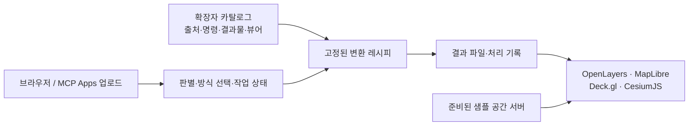

# geo — 공간 데이터 시각화

공간 데이터를 **수집 → 전처리 → 웹 형식 변환 → 지도·3D로 확인**하는 프로젝트입니다. 같은 원본을 파일 또는 공간 서버로 제공하는 방식과 웹 뷰어별 표현을 비교합니다.

**공개 사이트:** [geospatial.kro.kr](https://geospatial.kro.kr) · [데이터 시각화](https://geospatial.kro.kr/viz) · [내 파일 업로드](https://geospatial.kro.kr/viz/upload) · [AI 연결 안내](https://geospatial.kro.kr/ai)

[작업 범위](#scope) · [MCP Apps 연결 방법](#mcp-apps) · [배포 상태](#deployment) · [처리 구조](#architecture) · [라이선스](#license) · [개발 중인 사항](#in-progress)

## 작업 범위

카탈로그는 **8개 데이터 유형·26개 예시·71개 샘플 처리 경로**를 포함합니다. 준비된 예시를 열어 처리 단계와 결과를 비교하거나, 자신의 파일을 업로드해 파일 방식으로 변환하고 결과 지도·파일을 받을 수 있습니다.

아래 표는 **공개 배포의 파일 방식 업로드** 기준입니다. ✓는 해당 형식에 연결된 변환 결과를 표시할 수 있다는 뜻이며, 모든 뷰어가 원본 확장자를 직접 읽는다는 뜻은 아닙니다. 변환 방식에 따라 선택할 수 있는 뷰어가 달라집니다. Deck.gl 화면은 MapLibre 배경지도 위에 Deck.gl을 겹친 구성입니다.

| 데이터 | 업로드하는 확장자·묶음 | OpenLayers | MapLibre | Deck.gl | CesiumJS | 결과와 입력 조건 |
|---|---|:---:|:---:|:---:|:---:|---|
| 좌표 표 | `.csv` | ✓ | ✓ | ✓ | ✓ | 좌표 열이 있는 CSV → GeoJSON·MVT·PMTiles. UTF-8/CP949, 평면 좌표는 원본 좌표계 선택 |
| 2D Shapefile | `.zip` | ✓ | ✓ | ✓ | ✓ | `.shp`·`.shx`·`.dbf` 등 구성 파일을 함께 묶음. `.prj`가 없으면 좌표계 선택 |
| 2D GeoJSON | `.geojson`, `.json` | ✓ | ✓ | ✓ | ✓ | FeatureCollection → GeoJSON·MVT·PMTiles |
| GML | `.gml` | ✓ | ✓ | ✓ | ✓ | 일반 2D GML → GeoJSON·MVT·PMTiles. CityGML은 별도 형식 선택 |
| GeoPackage | `.gpkg` | ✓ | ✓ | ✓ | ✓ | 여러 레이어는 병합하여 변환 |
| FlatGeobuf | `.fgb` | ✓ | ✓ | ✓ | ✓ | GeoJSON·MVT·PMTiles로 변환 |
| 벡터 PMTiles | `.pmtiles` | ✓ | ✓ | ✓ | ✓ | 앞 세 뷰어는 PMTiles, CesiumJS는 변환한 GeoJSON 사용. 래스터 PMTiles 제외 |
| 높이·층수가 있는 2.5D 건물 | `.geojson`, `.json`, SHP 구성 파일 `.zip` | — | ✓ | ✓ | ✓ | 높이 속성 GeoJSON 돌출 또는 3D Tiles. MapLibre는 GeoJSON 돌출 경로 사용 |
| GeoTIFF·COG 영상 | `.tif`, `.tiff` (`.cog.tif` 포함) | ✓ | ✓ | ✓ | ✓ | COG·XYZ 래스터 타일. OpenLayers는 COG를 직접 읽는 경로도 제공 |
| 일반 영상 | `.jpg`, `.png`, `.webp` 또는 `.zip` | ✓ | ✓ | ✓ | ✓ | 단일 이미지·XYZ 타일. 제자리에 놓으려면 월드파일·`.prj`를 함께 ZIP으로 업로드 |
| DEM 지형 | `.img`, `.tif`, `.tiff` | — | ✓ | ✓ | ✓ | 높이 1밴드. MapLibre/Deck.gl은 Terrain-RGB, CesiumJS는 quantized-mesh |
| Quantized-mesh 지형 | `.zip` | — | — | — | ✓ | `layer.json`과 `.terrain` 타일 폴더를 함께 묶음 |
| LAS·LAZ 점군 | `.las`, `.laz` | — | — | ✓ | ✓ | 좌표계가 포함된 점군 → 3D Tiles |
| PNTS 점군 타일셋 | `.zip` | — | — | ✓ | ✓ | `tileset.json`과 `.pnts` 타일을 함께 묶음 |
| glTF 모델 | `.glb`, `.gltf` 또는 `.zip` | — | — | ✓ | ✓ | GLB·3D Tiles. 외부 `.bin`·텍스처가 있으면 glTF와 함께 ZIP으로 업로드 |
| CityGML | `.gml`, `.citygml` | — | — | ✓ | ✓ | CityGML 1.0/2.0 → 3D Tiles. 파일 좌표계 사용, 텍스처 미사용 |
| i3dm 인스턴스 타일셋 | `.zip` | — | — | — | ✓ | `tileset.json`·`.i3dm`·참조 모델을 함께 묶음. 현재 Deck.gl 경로는 지원하지 않음 |
| IFC BIM | `.ifc` | — | — | ✓ | ✓ | IFC2x3/IFC4 → GLB·3D Tiles. 현재 원래 위치와 무관하게 서울시청 앞에 배치 |

- **샘플에서만 제공하는 입력:** MVT(`.mvt`, `.pbf`) 예시가 있습니다. 타일 한 장은 위치(`z/x/y`)를 알 수 없어 업로드하지 않습니다. 타일 묶음을 벡터 PMTiles로 만든 뒤 `.pmtiles`로 업로드해야 합니다. CesiumJS의 MVT 예시는 대체 GeoJSON 결과를 사용합니다.
- **샘플 서버 방식:** 준비된 GeoServer·Martin 예시는 읽기 전용으로 열 수 있습니다. DEM의 OpenLayers 2D WMS나 2.5D 건물의 2D 지도처럼 위 업로드 표와 다른 표시 경로도 있습니다. 새 업로드를 서버의 DB 표·레이어로 발행하는 기능은 공개 배포에서 제공하지 않습니다.
- **입력 범위:** ZIP은 여러 파일이 필요한 형식을 위한 묶음입니다. KML/KMZ·DXF·GPX·MBTiles·ASC·OBJ/FBX·E57 등 카탈로그 밖 형식은 받지 않습니다. 이름이 같은 확장자라도 영상/DEM, 일반 GML/CityGML처럼 내용에 따라 형식을 골라야 합니다.
- **좌표와 위치:** 좌표계가 없으면 판별 화면의 안내에 따라 원본 좌표계를 선택합니다. 위치 정보가 없는 glTF·IFC·일반 이미지는 지정된 예시 위치에 놓으며, 정밀한 원위치 복원을 의미하지 않습니다.

실제 기준은 [형식별 카탈로그](shared/catalog), [뷰어별 출력 종류](shared/viewers.ts), [업로드 판별](shared/sniff.ts)입니다. [결과 화면 예시](docs/images/view-citygml.jpg)와 [점군 화면 예시](docs/images/view-las.jpg)도 볼 수 있습니다.

## MCP Apps 연결 방법

| 항목 | 값 |
|---|---|
| 서버 이름 | `geo` |
| 공개 MCP 주소 | `https://geospatial.kro.kr/mcp` |
| 전송 방식 | Streamable HTTP |
| 공개 배포 인증 | 로그인 없음 |
| 대화 안 화면 리소스 | `ui://geo/app.html` |

MCP Apps는 MCP 도구에 업로드·선택·진행·결과 화면을 붙이는 확장입니다. MCP 연결을 지원하는 것과 대화 안 앱 화면을 지원하는 것은 다릅니다. Apps 미지원 클라이언트는 도구의 텍스트 결과와 브라우저 주소를 사용합니다. [MCP Apps 공식 설명](https://apps.extensions.modelcontextprotocol.io/api/documents/overview.html).

1. MCP Apps를 지원하는 호스트에서 **사용자 지정 원격 MCP 서버/커넥터 추가**를 엽니다. 이름은 `geo`, URL은 위 `/mcp` 주소를 입력합니다. 인증 방식은 **로그인 없음 / No sign in**을 선택합니다. Claude의 현재 연결 절차는 [공식 커넥터 안내](https://support.claude.com/en/articles/11175166-get-started-with-custom-connectors-using-remote-mcp)를 참고합니다.
2. 대화에서 `geo` 커넥터를 켜고 **“공간 데이터 업로드 화면을 열어 줘”**라고 요청합니다. 모델이 인자 없이 `geo_identify`를 호출하면 업로드 화면을 엽니다.
3. **앱 화면 안에 파일을 올리고**, 판별된 형식·파일 변환 방식·필요한 좌표계를 고릅니다. 일반 채팅 첨부 파일이 자동으로 이 서버에 전달되는 구조는 아닙니다.
4. 변환을 시작한 뒤 진행 상태를 확인하고 결과 지도·내려받기 주소를 사용합니다. 대화 안 앱을 표시하지 못하면 [브라우저 업로드 화면](https://geospatial.kro.kr/viz/upload)을 사용합니다.

| 공개 도구 | 역할 |
|---|---|
| `geo_formats` | 받을 수 있는 형식과 현재 허용한 파일 변환 방식 조회 |
| `geo_identify` | 업로드 화면 열기, 맡긴 파일의 형식·좌표계·방식 판별 |
| `geo_convert` | 맡긴 파일을 선택한 형식·방식으로 변환 시작 |
| `geo_status` | 작업 진행·실패 이유·완료 후 지도와 결과 주소 조회 |
| `geo_stage_chunk` | 앱 화면의 파일 조각 업로드용 내부 도구 |

공개 연결에서는 **외부 URL 가져오기와 서버 PC 파일 경로 읽기를 제공하지 않습니다.** `geo_engine`의 Unreal 실행과 개발 중인 국내 주소·코드 연계 도구도 공개 기능에 포함하지 않습니다. 호스트의 도구 승인·앱 표시·내려받기 지원은 해당 클라이언트의 기능에 따릅니다.

## 배포 상태

기준일: **2026-11-01**. GitHub 저장소의 코드·문서와 서버에 준비된 데이터는 구분합니다. 대용량 원본·변환 결과는 Git에 넣지 않고 서버에 보관합니다.

| 기능 | 공개 배포 상태 |
|---|---|
| 웹 화면·4종 웹 뷰어 | [geospatial.kro.kr](https://geospatial.kro.kr)에서 제공 |
| 예시 데이터 | 26개 형식·71개 샘플 처리 경로 준비 완료 |
| 흐름도 | Windows/OS 움직임 줄이기 설정과 관계없이 기본 재생, 직접 끄기 가능 |
| MCP Apps·파일 업로드 | 공개 MCP 연결·파일 업로드·파일 방식 변환·진행 확인·지도·다운로드 지원 |
| 기존 GeoServer·Martin 예시 | 준비된 레이어의 읽기 전용 조회 제공 |
| Cesium for Unreal | 서버에 설치·실행하지 않으며 화면 전환 비활성화 |
| 국내 주소·코드 연계(`/link`) | 개발 중인 화면. 공개 완료 기능에서 제외 |

### 배포 화면에서 현재 불가능한 사항

- 업로드한 데이터를 PostGIS·GeoServer·Martin의 새 서비스로 발행하거나 관리 API를 호출할 수 없습니다. 공개 업로드는 결과 파일을 만드는 방식으로 제한합니다.
- URL을 입력해 서버가 대신 내려받거나, 서버 PC의 파일 경로를 지정해 읽을 수 없습니다. 브라우저 또는 MCP Apps 업로드 화면으로 파일을 전달합니다.
- 파일은 **최대 200MB**, 변환은 **서버 전체에서 동시에 1개**입니다. 다른 변환이 실행 중이면 대기열에 쌓지 않고 다시 시도하도록 알립니다. 처리 가능한 형식이어도 파일 크기·구조·도구의 처리 시간에 따라 실패할 수 있습니다.
- 계정별 비공개 파일 보관함을 제공하지 않습니다. 업로드 원본과 결과는 운영자가 명시적으로 정리하기 전까지 보존합니다.
- Cesium for Unreal의 실제 엔진 화면·Pixel Streaming과 `geo_engine` 실행은 제공하지 않습니다. 웹 CesiumJS 지도는 별도로 사용할 수 있습니다.
- 표에 없는 확장자, 단독 MVT/PNTS/i3dm/terrain 타일, 카탈로그가 지원하지 않는 모델 확장이나 참조 파일 누락을 자동으로 보완하지 않습니다.

## 처리 구조

웹 화면은 Nuxt 4·Vue 3·TypeScript, 변환은 Node 실행기와 버전을 정한 Docker 도구를 사용합니다. GDAL·PDAL·tippecanoe·mago·py3dtiles·IfcConvert 등은 형식별 레시피로 연결됩니다. 처리 명령과 로그·시간은 실행 기록에 남고 화면은 카탈로그와 그 기록을 읽습니다. 서버의 데이터 처리는 별도 rootless Docker 엔진을 사용합니다. [구현·운영 상세](docs/visualization.md), [배포 구성](deploy/README.md).

## 라이선스

| 대상 | 적용 조건 |
|---|---|
| 이 저장소의 자체 코드·문서 | **[MIT License](LICENSE)**, Copyright © 2026 Gi-Di-Zi. 사용·수정·재배포 시 저작권과 허가 문구를 유지하며 무보증 조건이 적용됩니다. |
| 샘플 원본·변환 결과·모델·타일 | **각 원본 데이터의 라이선스**를 따릅니다. 이 저장소의 MIT가 데이터 이용·재배포 권한을 대신하지 않습니다. 출처표시·가공 표시·재배포 조건은 각 자료별로 확인해야 합니다. |
| 사용자가 업로드한 자료 | 저장소의 MIT 적용 대상이 아닙니다. 해당 자료의 원래 이용조건과 권리 범위를 따릅니다. |
| 배경지도·외부 서비스 | OpenStreetMap 등 각 제공자의 이용조건과 출처표시를 따릅니다. VWorld처럼 키·이용승낙이 필요한 서비스는 별도 조건이 적용됩니다. |
| 외부 라이브러리·Docker 도구 | 각 배포본의 원래 라이선스가 적용됩니다. GPL/LGPL/MPL/Apache/BSD/MIT 등 여러 조건의 도구가 포함되며 모두 MIT로 재허가하는 프로젝트가 아닙니다. |
| Cesium for Unreal 플러그인 | [Apache License 2.0](https://cesium.com/learn/cesium-unreal/ref-doc/)을 따릅니다. Cesium ion과 외부 데이터 서비스를 이용하면 해당 서비스·콘텐츠의 조건도 별도로 적용됩니다. |
| Unreal Engine | **[Epic의 Unreal Engine 라이선스·EULA](https://www.unrealengine.com/license)**를 따릅니다. 프로젝트 코드의 MIT와 별개이며 엔진 자체를 MIT로 제공하지 않습니다. |

데이터 출처와 표기는 [형식별 `collect` 정의](shared/catalog)와 [출처 목록](shared/catalog/sources.ts), 도구의 라이선스·공식 주소는 [도구 카탈로그](shared/catalog/tools.ts)에서 확인할 수 있습니다. 카탈로그에 다른 수급처를 소개했다고 해당 자료를 이 서버에서 제공하거나 재배포를 허용한다는 의미는 아닙니다.

## 개발 중인 사항

| 기능 | 현재 상태와 남은 작업 |
|---|---|
| 국내 주소·코드 연계 도구(`/link`) | PNU·법정동·행정동·주소·위치 연계를 별도 확장 기능으로 개발 중입니다. 기준 자료·외부 API·후보 관계 검증이 진행 중이며 완성된 주소 변환 서비스로 안내하지 않습니다. |
| 업로드 범위 확장 | 현재 표의 파일 변환 방식을 기준으로 제공합니다. 새 서버 레이어 발행, 단독 타일의 위치 복원, 추가 확장자는 공개 업로드 지원에서 제외합니다. |
| 모델의 원위치 배치 | glTF·IFC의 위치 입력·지리참조 개선이 남아 있습니다. 현재 지정 위치의 미리보기와 원래 좌표를 이용한 배치를 구분합니다. |
| Cesium for Unreal 화면 | 웹 CesiumJS와 다른 실행 환경입니다. 실제 엔진·플러그인·GPU와 화면 송출 구성이 필요합니다. 저장소의 자동 실행기는 Windows 전용이므로 Linux 서버에 적용하려면 별도 이식이 필요하며, 현재 엔진 실행·외부 스트리밍 연결은 비활성 상태입니다. |
| MCP 호스트별 앱 연동 | 서버의 프로토콜·앱 리소스 응답과 대화 안 앱 표시는 별개입니다. 호스트별 앱 표시·도구 승인·파일 내려받기는 해당 클라이언트에서 추가 확인이 필요합니다. |
